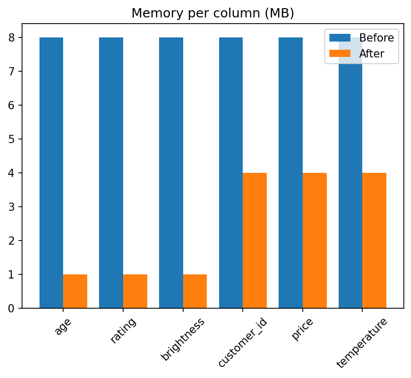
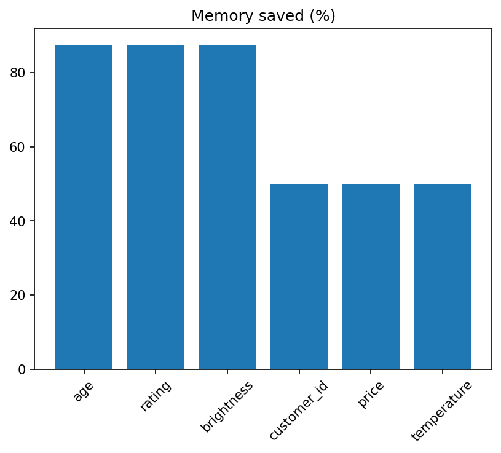

# NumPy Dtype Optimizer

Automatically picks the smallest safe data type for each column of a 1M-row dataset to cut memory usage, without losing data.

## What it does
- Builds a fake customer dataset (age, rating, brightness, customer_id, price, temperature) as NumPy arrays
- Finds each column's min/max and picks the smallest integer type that fits
- Chooses float32 or float64 by checking the rounding error
- Verifies the converted data matches the original
- Demonstrates silent overflow when the wrong type is chosen
- Compares sum speed before and after optimization

## Results

| Column | Before | After |
|---|---|---|
| age | int64 (8 bytes) | uint8 (1 byte) |
| rating | int64 (8 bytes) | uint8 (1 byte) |
| brightness | int64 (8 bytes) | uint8 (1 byte) |
| customer_id | int64 (8 bytes) | uint32 (4 bytes) |
| price | float64 (8 bytes) | float32 (4 bytes) |
| temperature | float64 (8 bytes) | float32 (4 bytes) |

- **Memory:** 48 MB -> 15 MB (68.8% saved)
- **Data integrity:** all integer columns matched the original exactly; float differences were tiny (about 0.0002 for price)
- **Speed:** summing all columns took 4.37 ms before and 2.48 ms after (about 1.8x faster; varies by machine)
- **Wrong dtype demo:** storing brightness as int8 corrupted about 50% of values, and customer_id as int16 corrupted about 99%, with no error shown

## NumPy concepts used
2D arrays, dtype, astype, nbytes, axis, broadcasting, boolean masks, fancy indexing, argmax, np.where, np.iinfo

## How it works
1. Generate 1M rows of data with `np.random.default_rng`
2. Find each column's min and max using `axis=0`
3. Compare them against the limits of 7 integer types using broadcasting, which creates a True/False `fits` table
4. Use `argmax` to pick the first (smallest) type that fits
5. Convert each column with `astype` and verify nothing changed

## How to run
Open the notebook in Google Colab and click **Runtime > Run all**. No installation is needed.

[Open in Colab](https://colab.research.google.com/drive/15KNJOCP1u1dhxQsYVsJDbifEcBhgblwV?usp=sharing)

## What I learned

**About NumPy**
- NumPy uses `int64` and `float64` by default, which uses more memory than many datasets need. My 1M-row dataset took 48 MB by default but only 15 MB after choosing better types.
- A data type is chosen by its range. `uint8` holds 0 to 255 and `int8` holds -128 to 127, so I have to know the minimum and maximum of my data before choosing.
- I practiced `axis=0` to get one result per column, broadcasting to compare 4 columns against 7 types at once, boolean masks to find the types that fit, and `argmax` with fancy indexing to pick the smallest one.

**About risks**
- Choosing a type that is too small does not raise an error. The values silently wrap around. Storing brightness as `int8` corrupted about 50% of my data, and storing customer_id as `int16` corrupted about 99%.
- Because of this, I verified my converted data with `np.array_equal` before trusting it.
- Smaller float types lose precision. `float32` was fine for my data (error under 0.01), but `float16` can overflow to `inf`.

**About measuring**
- Memory savings were large (68.8%), but the speed gain was smaller (4.37 ms to 2.48 ms). I learned to measure results instead of assuming them.
- Timing results change between runs and machines, so I report them as approximate.

**What I would improve next**
- Test on real datasets instead of generated data.
- Add support for more column types, such as booleans and categories.
- Try the same idea with pandas.
